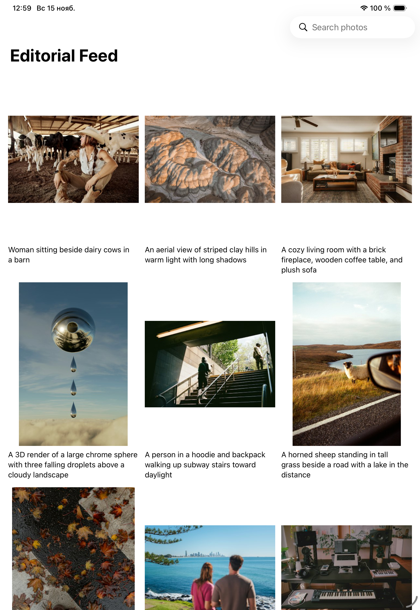
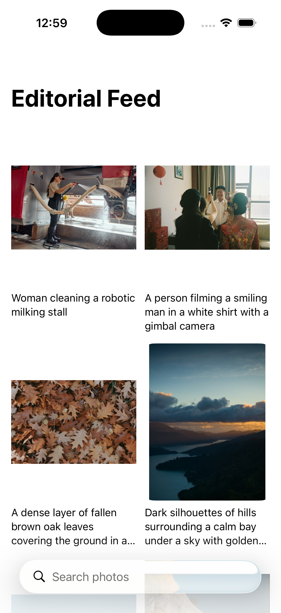
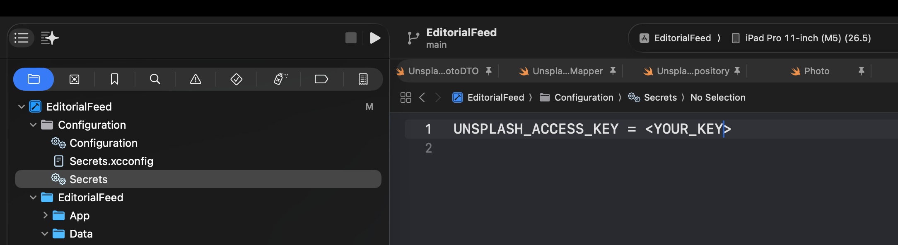
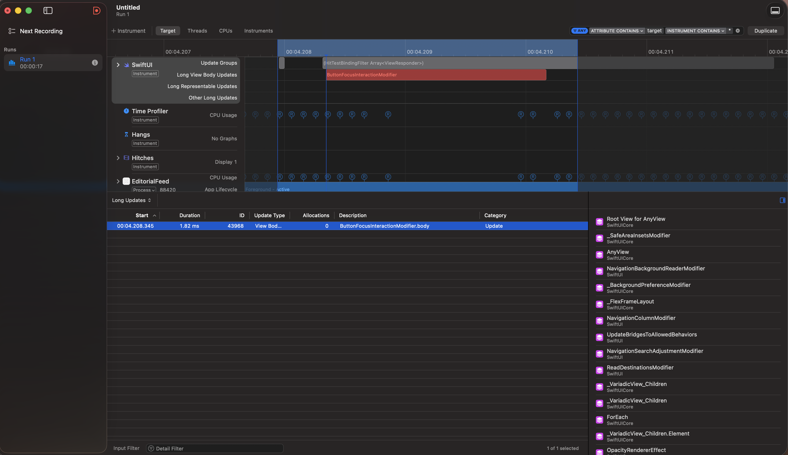
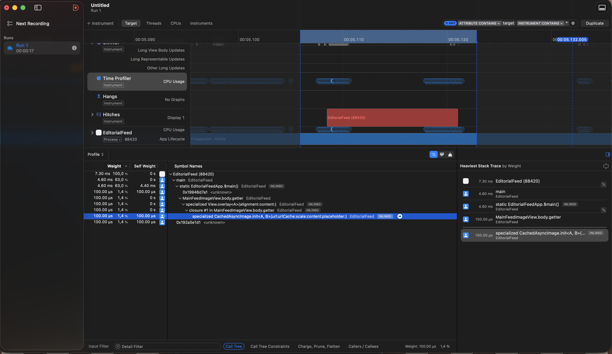

# EditorialFeed

EditorialFeed is an iOS application for browsing Unsplash photos and searching for images. The main screen presents an endless gallery, and a selected photo can be opened on a dedicated screen.

<p align="center">
  
  
</p>

## Technologies

- Swift and SwiftUI;
- minimum deployment target: iOS 17.0;
- Swift 6 language mode;
- Swift Concurrency and Observation;
- default `MainActor` isolation;
- `async/await` and `URLSession` for network requests;
- Swift Testing for unit tests;
- no third-party libraries.

## Project Setup

The application requires an Unsplash Access Key.

1. Create an application in [Unsplash Developers](https://unsplash.com/developers) and obtain an Access Key.
2. Open `EditorialFeed/EditorialFeed.xcodeproj` in Xcode.
3. Create a new file in the `Configuration` folder.
4. Select the `Configuration Settings File` template, create a file named `Secrets.xcconfig`, and save it in `EditorialFeed/Configuration`.
5. Add your Access Key to the new file, following `Secrets.xcconfig.example`:

   ```text
   UNSPLASH_ACCESS_KEY = YOUR_REAL_ACCESS_KEY
   ```

6. Run the `EditorialFeed` target.



`Secrets.xcconfig` is listed in `.gitignore` and must not be committed to the repository. If the key is missing, the application displays a dedicated configuration error screen.

## Implemented Features

### Main Feed

- editorial feed powered by the Unsplash API;
- adaptive grid with two columns in compact width and three columns in regular width;
- endless pagination with 20 photos per page;
- next-page loading when the user approaches the final six items;
- duplicate removal using the stable `Photo.id`;
- a dedicated pagination error with Retry;
- PhotoDetails opening when a card is tapped.

The UI layer resolves the photo description in the following order:
1. a non-empty `alt_description`;
2. a non-empty `description`;
3. the localized `Untitled photo` placeholder.

### Search

- photo search using the system `.searchable` modifier;
- a 400 ms search debounce;
- whitespace trimming in the search query;
- cancellation of obsolete search requests;
- the same adaptive grid and endless pagination as the editorial feed;
- a dedicated empty state when a search returns no results;
- preservation of the editorial feed when switching to search.

### PhotoDetails

- a dedicated screen for the selected photo;
- progressive loading: the `small` URL is displayed first, followed by `regular`;
- attribution with links to the photographer and the photo on Unsplash;
- a zoom transition from the image on iOS 18;
- standard system push/pop navigation on iOS 17;
- system Back navigation and interactive edge swipe to return to the gallery.

### Shared States and Networking Behavior

- loading, empty, and error states;
- retry for initial loading and pagination;
- clear handling of offline, timeout, authentication, and rate-limit errors;
- unit tests for configuration, networking, pagination, and presentation logic.

## Architecture

The project uses a single target. This keeps infrastructure overhead appropriate for the scope of the assignment, while logical boundaries are expressed through folders, protocols, and explicit dependency injection.

```text
EditorialFeedApp
├── App       — composition root and platform adapters
├── Domain    — Photo, PhotoPage, and PhotoRepository
├── Data      — URLSession client, DTOs, mapping, and repository
└── Features
    ├── MainFeed
    ├── MainFeedFlow
    ├── PhotoDetails
    └── Shared/Presentation
```

### MainFeed

The primary data flow is unidirectional:

```text
Unsplash API
    ↓
PhotoRepository
    ↓
EditorialFeedService
    ↓
MainFeedViewModel → MainFeedViewStateBuilder → MainFeedViewState
    ↑                                           ↓
    └────────────── MainFeedViewEvent ─── MainFeedView
```

Responsibilities are divided as follows:

- `EditorialFeedService` performs initial, search, and pagination requests; stores editorial and search contexts; accumulates pages; and removes duplicates;
- `MainFeedViewModel` handles semantic UI events, search debounce, the pagination-threshold decision, and screen navigation;
- `MainFeedViewStateBuilder` transforms the service model into render state;
- `MainFeedView` only renders state and sends events;
- `MainFeedFlowCoordinator` creates the destination module through a factory and owns navigation state.

### PhotoDetails

PhotoDetails is implemented as a separate UI module with its own View, ViewModel, ViewStateBuilder, and factory. MainFeed only expresses the intent to open a domain `Photo`.

On iOS 18, the grid image is connected to PhotoDetails through `matchedTransitionSource` and `navigationTransition(.zoom)`. On iOS 17, the same destination is presented using the standard system push transition.

## Performance Decisions

### Lazy Grid

The grid is built with `ScrollView` and `LazyVGrid`. SwiftUI creates only the cells needed for the current viewport, while `ForEach` uses the stable API `Photo.id`.

### Image Sizes

The grid uses the `small` image URL, while PhotoDetails uses `regular`.

### Image Loading and Cache

`CachedAsyncImage` uses a `URLSession` configured with `URLCache`. The grid cache is configured with a 50 MB memory capacity and a 200 MB disk capacity.

SwiftUI View initialization does not read from the cache or decode an image synchronously. Loading starts in a cancellable `.task`, so constructing the grid is not blocked by reading cached data.

The current implementation is a baseline rather than a complete advanced image pipeline. It does not yet provide a shared decoded-image cache, downsampling for the actual view size, in-flight request deduplication, or prefetching.

## Performance

Preliminary scrolling profiling was performed with SwiftUI Instruments, Time Profiler, Hangs, and Hitches.

During a short profiling run:
- no hangs were detected;
- one system `ButtonFocusInteractionModifier` Long View Body Update was detected, lasting 1.82 ms;
- several 12.5 ms hitches were detected;
- `MainFeedImageView.body` and `CachedAsyncImage.init` each took approximately 100 μs in the selected interval;
- no visual stuttering was noticeable while using the application.

Long View Body Update:


Hitch:


These results do not appear critical, but they highlight opportunities for further image-loading optimization. 

## Testing

Unit tests are written with Swift Testing.

The tests cover:
- reading and validating local configuration;
- query parameters for the editorial feed and search;
- parsing `/photos` and `/search/photos` responses;
- handling the `Link` header and `total_pages`;
- malformed JSON and API errors;
- initial loading and Retry;
- pagination threshold and appending the next page;
- prevention of parallel pagination requests;
- photo deduplication;
- stopping after the final page;
- inline pagination error and Retry;
- mapping a domain photo to a UI item;
- navigation using the selected `photoID`.

## Trade-offs and Limitations

- The project is not split into separate framework targets; for its current scope, a single target with internal boundaries is sufficient.
- The image loader currently creates a separate `URLSession` for each `CachedAsyncImage` instance.
- Full-size images are decoded without downsampling.
- There is no offline mode or persistent feed metadata storage.
- Pull-to-refresh is not implemented.
- PhotoDetails does not support pinch-to-zoom.
- The advanced zoom transition is available only on iOS 18; iOS 17 uses a standard system push.
- UI smoke tests and snapshot tests are not yet implemented.

## Potential Improvements

- move image loading into a centralized pipeline;
- introduce shared `URLSession` and `URLCache` instances;
- perform downsampling outside `MainActor`;
- implement in-flight request deduplication and reference-counted cancellation;
- prefetch nearby images;
- repeat Instruments profiling after these optimizations;
- add pull-to-refresh;
- expand the handling and presentation of server and decoding errors;
- add snapshot and UI smoke tests;
- consider an offline metadata cache.

## AI Usage

AI was used as a pair-programming tool throughout development:

- to decompose the requirements and prepare an implementation plan;
- to discuss UI-module boundaries and component responsibilities;
- to prepare and refactor individual sections of code;
- to update unit tests;
- to prepare documentation.

Architectural decisions were made iteratively: AI suggestions were evaluated against the assignment requirements, Unsplash API behavior, and manual application checks. Application testing and Instruments profiling were performed manually without AI.
